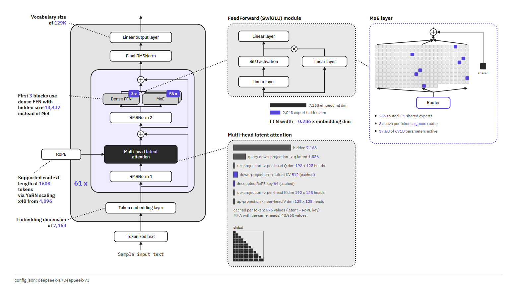

# LLM Architecture Viewer

Type a Hugging Face model id, get an architecture diagram drawn from its `config.json`.

I liked Sebastian Raschka's [LLM Architecture Gallery](https://sebastianraschka.com/llm-architecture-gallery/)
but it only covers the models he has drawn by hand, so I wanted the same kind of figure for any model on the Hub.
The layout here borrows from his figures; the drawings themselves are generated in the browser and none of his
images are used.



## What it shows

- The block stack: norms (pre / post / sandwich), attention type, FFN or MoE, position encoding, layer count
- Models that mix layer kinds (Gemma 3 sliding/global, Qwen3-Next DeltaNet/attention, Granite 4 Mamba-2/attention)
  get one colored box per kind with its layer count, plus a per-layer strip under the figure
- Detail panels that change shape with the config:
  - attention: query heads grouped onto KV heads (MHA / GQA / MQA), the MLA compression path, and a small mask
    for each attention kind (global, sliding window, chunked, attention sinks)
  - MoE: one cell per expert, with the experts a single token uses filled in
  - FFN width against the embedding width
  - Mamba / Gated DeltaNet / short-conv internals for the non-attention mixers
- Parameter counts per component, computed from the config and compared against the safetensors total the Hub
  reports

## Running it

No build step. Open `index.html` in a browser, or on Windows double-click `run.bat`.

`run.bat` starts `serve.py` (Python standard library only) on `http://127.0.0.1:47652/`. The only reason for the
server is gated repos: it forwards Hub requests with the token from your local `huggingface-cli login`
(`HF_TOKEN`, or `~/.cache/huggingface/token`). The token stays in that process and never reaches the page.
Without it, gated models like Llama or Gemma fall back to a public re-upload of the same name (e.g. `unsloth/...`),
which has the same config.

You can also drop a `config.json` onto the page instead of typing a model id.

## How it works

- `arch.js` turns a config into a normalized spec. Most of the work is here, because every model family names
  things differently (`n_embd` vs `hidden_size`, `layer_types` vs `sliding_window_pattern` vs
  `hybrid_override_pattern`, nested `text_config` for multimodal models, ...)
- `diagram.js` draws the main figure from the spec; `inset_*.js` draw the detail panels; `svgkit.js` holds the
  shared SVG helpers
- `app.js` handles the Hub requests, the gated-repo fallback, and the tables
- `strings.js` has the UI text (English, Korean)

## Tests

```
node --test tests/arch.test.js tests/diagram.test.js tests/inset_attention.test.js tests/inset_moe.test.js tests/inset_mixer.test.js
```

(or `test.bat`). `tests/fixtures/` has 23 real configs, from GPT-2 and BERT to DeepSeek-V3, Kimi K2, gpt-oss,
Qwen3-Next and Granite 4. The computed parameter totals are checked against the Hub's safetensors totals.

`node tests/browser_smoke.mjs` loads a few real models in headless Chrome and checks the page at desktop and
phone widths. It needs network access.

## Known limits

- Parameter counts come from the config only. Weights the config doesn't describe (DeepSeek's multi-token
  prediction layer, vision towers of multimodal models) are left out, so the total can differ from the
  safetensors number by a few percent
- Encoder-decoder models (T5) are drawn as a single stack
- A new architecture with unusual config fields may parse partly; the page lists what it couldn't read under
  "Parsed config"

## Notes

I built this with a fair amount of help from Claude (Anthropic), mostly for the config parsing across model
families and the test fixtures. I checked the figures against the original configs and papers and changed what
looked wrong.
